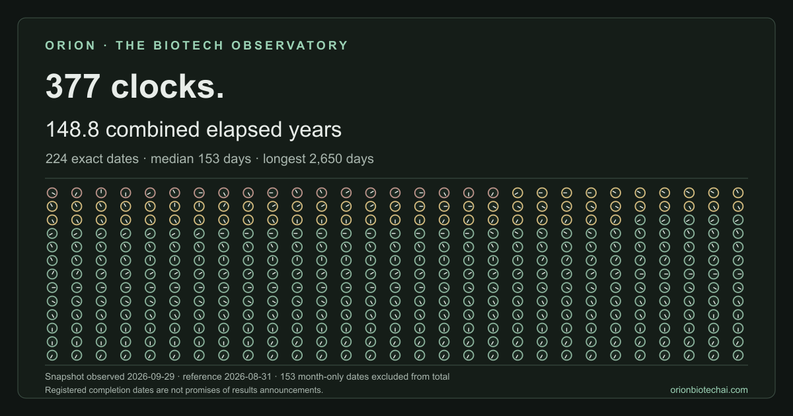

In the ClinicalTrials.gov snapshot observed on 29 September 2026, **377 of
3,762 active industry Phase 3 trials (10%)** still listed an estimated primary
completion date on or before 31 August 2026.

[Read the Stale Clock report](https://www.orionbiotechai.com/reports/stale-clock/2026-09-29)
· [Get the free weekly note](https://orionweekly.beehiiv.com/)

From the extracted repository root, reproduce the retained snapshot offline:

```sh
node bin/orion-stale-clock.js reproduce --input data/2026-09-29/snapshot.json --compare-csv data/2026-09-29/data.csv
```

Find matching records reproducibly from the official ClinicalTrials.gov API.
This is not a finding of delay or noncompliance.

Our mission: **Give humanity and its AIs a memory of medicine that no one can rewrite.**
Contact: [hello@orionbiotechai.com](mailto:hello@orionbiotechai.com).

## ORION Stale Clock

Node.js 22 or newer and Git are required. There are no external runtime
dependencies, paid APIs, database credentials or install-time network hooks.

### Install from the public source repository

Use this after the reviewed public repository opens:

```sh
git clone https://github.com/jiwoo4292-png/orion-stale-clock.git && cd orion-stale-clock && npm install --global .
```

This installs the local source. No published npm package or container registry
image is required. For an extracted archive, use `node bin/orion-stale-clock.js`
in place of `orion-stale-clock`.

### Make a fresh local query

```sh
orion-stale-clock measure --condition obesity --phase PHASE3 --reference-date 2026-08-31 --out results/obesity
```

```sh
orion-stale-clock measure --sponsor "<registered sponsor name>" --phase PHASE3 --reference-date 2026-08-31 --out results/sponsor
```

Condition, registered lead-sponsor name, phase and active statuses are configurable
filters. Output stays on your computer. Only the
[official ClinicalTrials.gov API](https://clinicaltrials.gov/data-api/api) is used.

### Check the frozen CSV

```sh
orion-stale-clock verify --csv data/2026-09-29/data.csv --expected-sha256 be429676b07fa0bd6077311c8368110b79bf43aadc9806c8d58fbf84a821cff5
```

Offline reproduction recalculates A377/B226/C82/D331 of552 from the minimal
3,762-record source projection. `--compare-csv` checks the exact frozen bytes
as well as the recomputed rows. The 377-row CSV alone cannot reproduce the full
population or D.

### Docker, from the repository root

```sh
docker build -t orion-stale-clock . && docker run --rm orion-stale-clock reproduce --input data/2026-09-29/snapshot.json --compare-csv data/2026-09-29/data.csv
```

### What's included

- Frozen 377-row CSV and exact SHA-256.
- Minimal allowlisted 3,762-record projection for denominator reproduction.
- Source/processing notice, date-precision methodology and original Wall image.
- Dependency-free CLI and tests.

`METHODOLOGY.md` defines A/B/C/D, date intervals, missing values and next checks.
`data/2026-09-29/provenance.json` lists exact files and hashes.

## Limits

- Registered completion dates are not promises of results announcements.
  Sponsors may update their records at any time.
- The Wall's 224 exact-day records add up to 148.8 combined elapsed years.
  Its 153 month-only records are excluded from that sum. The clocks symbolize
  estimated completion dates, not how long every part of a record went unchanged.
- A fresh query returns the source's current state and may differ from the
  September snapshot. Observation time is the actual retrieval time, even when
  an earlier calculation reference is supplied. This is not historical `as_of`.
- Search results are a registry search candidate set, not an indication-classified
  population. Lead-sponsor text is not an issuer/ticker or parent-company identity
  claim. PHASE3 includes combined Phase 2/3 and preserves the phase label.
- Do not combine a new custom cohort with the frozen report's denominator.
  Incomplete pagination and unavailable data do not become successful zero results.
- Requests run sequentially with a default one-second interval. This is a project
  policy, not a claimed official API quota.
- Matching hashes prove matching bytes, not truth, first discovery or a provider
  timestamp. The mission is aspirational; this release does not establish an
  unchangeable database, an operating daily seal or external timestamp proof.
- The next frozen-cohort recheck is planned for 26 October. Its result is not known.
- Native execution and a local Node 22 Docker build/run were checked on
  30 September 2026. These checks do not establish an external timestamp proof.
- Verification and read-only MCP repositories have separate release gates and
  are not available features of this release.

## Citation

Source: ORION Biotech Observatory (orionbiotechai.com), observed 2026-09-29

Use `data/2026-09-29/data.csv` for exact verification and reproduction.
The optional `data.attributed.csv` adds only a `source_attribution` column
for citation when sharing records. It is a derivative with its own SHA-256
and is not accepted by the strict 19-column CSV verifier. The original snapshot,
reference date, record order and field values are unchanged.

## Licenses and reuse

Original software: **MIT**, see `LICENSE`. ORION-authored methodology and original
contributions: **CC BY 4.0**, within the scope in `LICENSE-DATA.md`.
Copyright (c) 2026 ORION BIOTECH.
Source data retains ClinicalTrials.gov's terms and any applicable third-party
rights. ORION does not claim ownership of its database; see `NOTICE-SOURCES.md`.

ORION supplies dated facts, not scores, rankings, recommendations, price targets
or forecasts. Users' own analyses are their responsibility and must not imply
ORION endorsement. No proprietary use restriction is added to MIT or CC BY.

## Contribute

Read `CONTRIBUTING.md`; keep each observation's original source and actual time.
Run `npm test`. Report corrections without silently rewriting old dated releases.
Never submit private credentials, patient information or registry contact lists.


## Summary chart review candidate

Reproduce the proposed frozen summary charts offline with:

```sh
node bin/reproduce-summary-charts.js --out results/summary-charts-review
```

Use a new output directory. The command verifies both the selected CSV and the
full 3,762-record snapshot; no requests or source rewrites occur. It includes
accessible tables, calendar-month boundary definitions and a 1200×630 SVG.
The “Other records” complement label and new presentation remain a Draft for
Claude review, not a claim that all complementary dates are in the future.
See [SUMMARY-CHARTS.md](SUMMARY-CHARTS.md) for the precision and provenance rules.
